# ট্র্যাকার নিজে-যোগ করার উইজার্ড — নকশা (আপনার অনুমোদনের জন্য)

শুধু নকশা, এখনো বানানো হয়নি। ডিজাইন সিস্টেম V2-এর আসল রং ও উপাদান দিয়ে আঁকা; নমুনা ডেটা। বাংলা/ইংরেজি, আলো থিম; ধাপ ৫-এর অন্ধকার থিমও আছে। পরিকল্পনা ও পরের ধাপ: `owner_actions/TRACKER_WIZARD_PLAN_BN.md`।

অনুমোদন দিলে STATUS-এ "ট্র্যাকার উইজার্ড ঠিক" লিখুন; বদল চাইলে কোন ছবিতে কী বদলাবেন লিখুন।

## ১. কোন ট্র্যাকার চলে + কোথায় কিনবেন

| বাংলা | English |
|---|---|
| 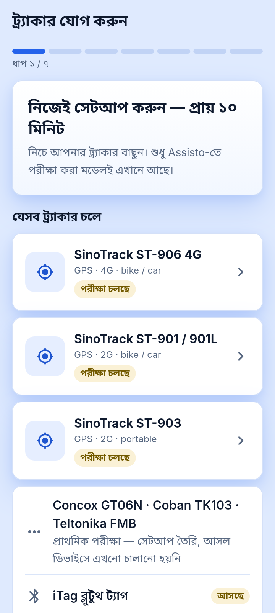 | 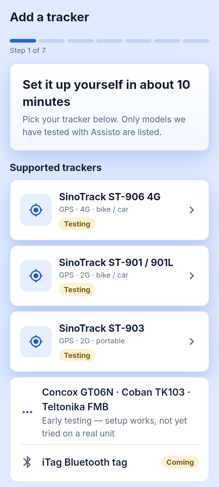 |

## ২. মডেল বাছাই — কী কী লাগবে

| বাংলা | English |
|---|---|
| 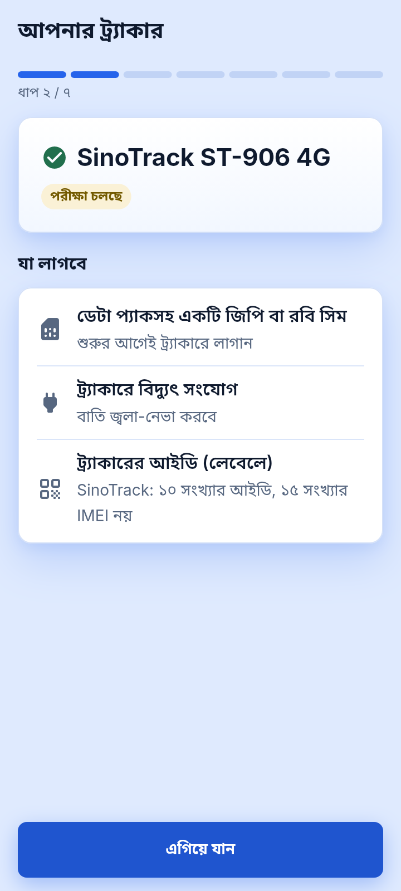 | 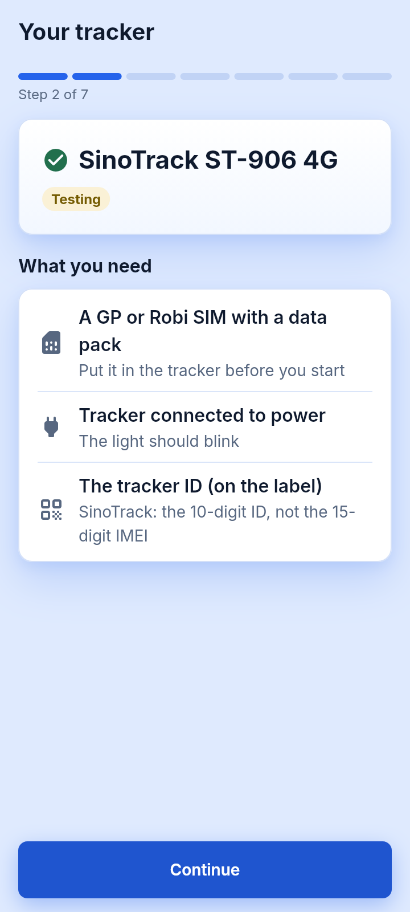 |

## ৩. ট্র্যাকারের আইডি — স্ক্যান বা লিখুন (SinoTrack-এ ১০ সংখ্যা, IMEI নয়)

| বাংলা | English |
|---|---|
| 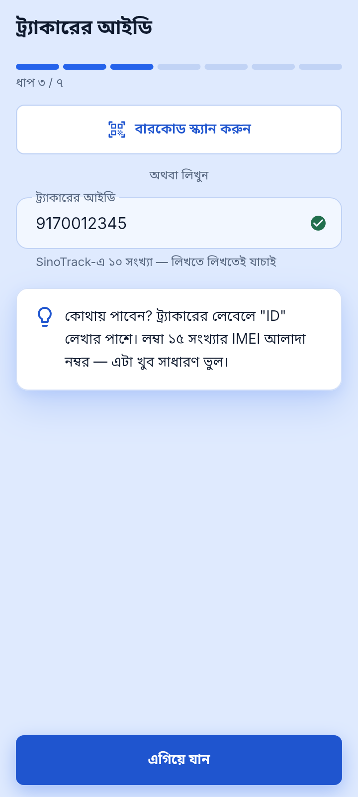 | 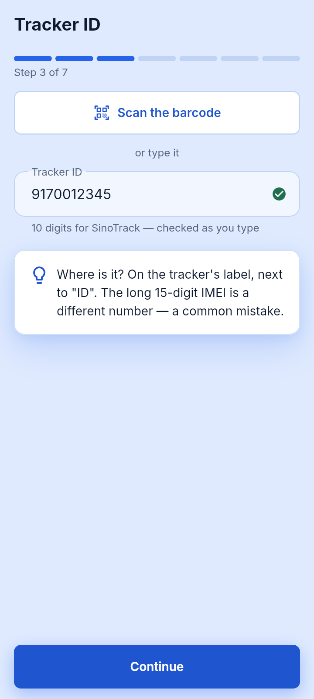 |

## ৪. জিপি বা রবি সিম + ট্র্যাকারের নম্বর

| বাংলা | English |
|---|---|
| 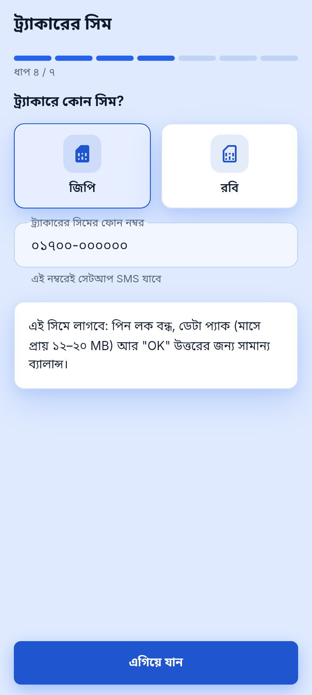 | 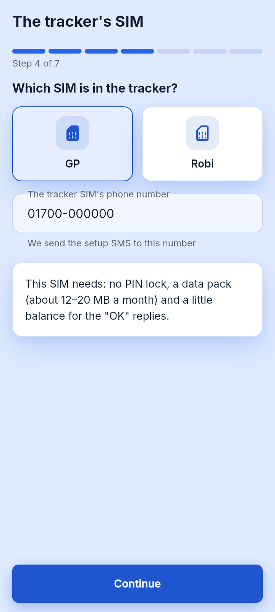 |

## ৫. সেটআপ SMS — প্রতিটি বোতাম SMS অ্যাপ খুলে বার্তা লিখে দেয়, আপনি শুধু Send চাপেন

| বাংলা | English |
|---|---|
| 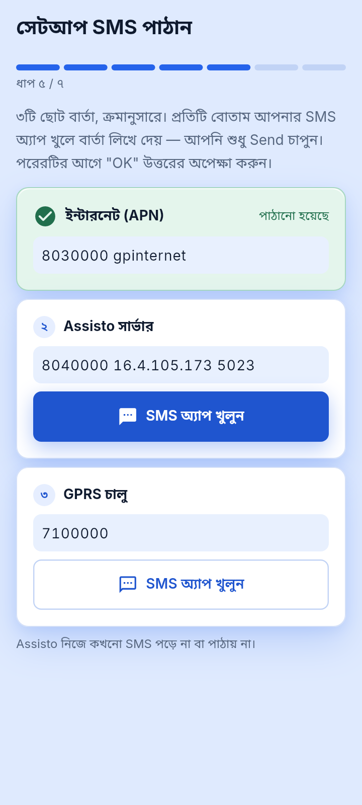 | 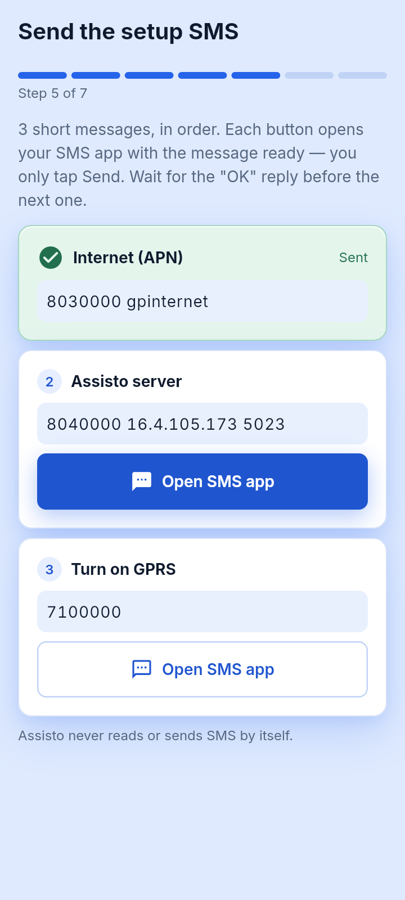 |

অন্ধকার থিম:

| বাংলা | English |
|---|---|
| 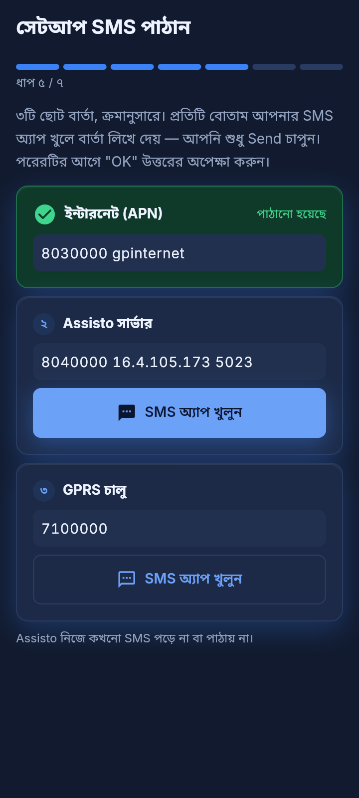 | 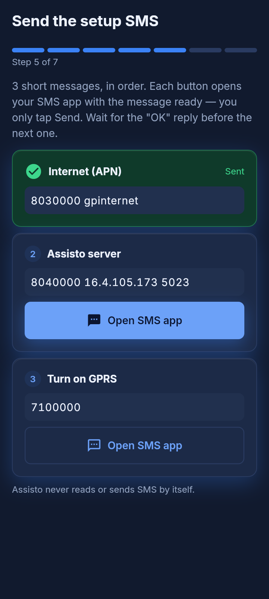 |

## ৬. অপেক্ষা — সত্যিকারের টাইমার ও কী দেখে নিতে হবে

| বাংলা | English |
|---|---|
| 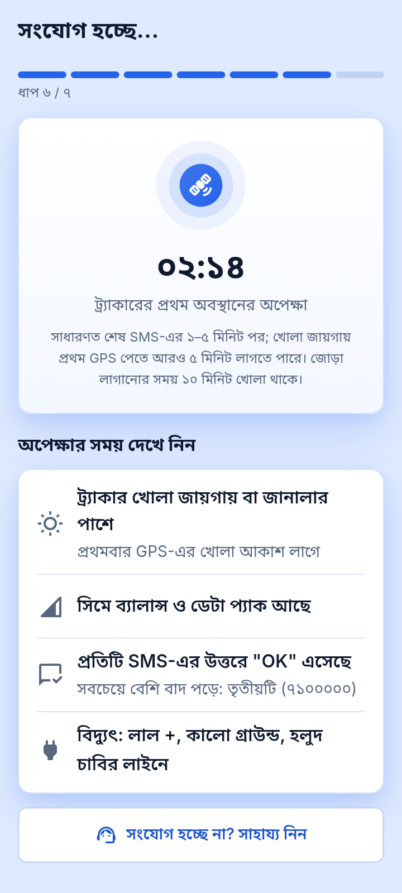 | 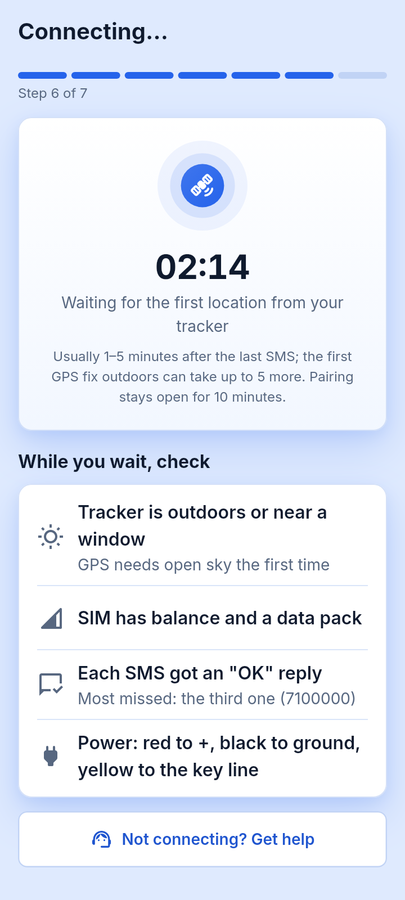 |

## ৬খ. ট্র্যাকার সংযুক্ত

| বাংলা | English |
|---|---|
| 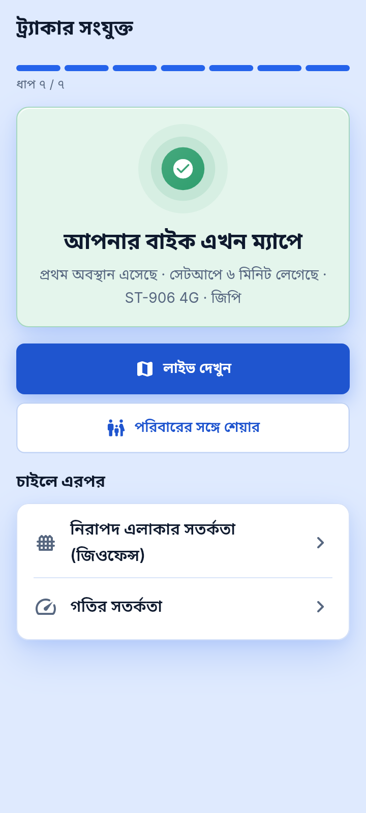 | 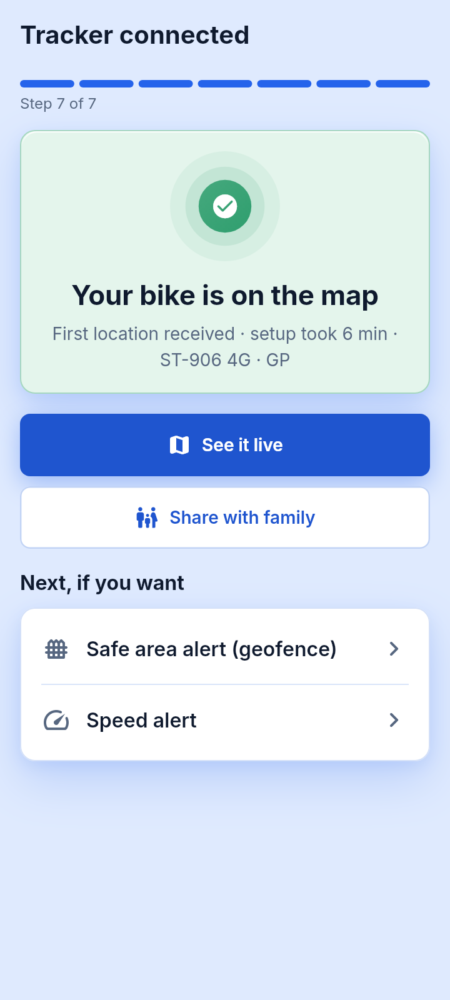 |

## ৭. সাহায্য — আগে Assisto চ্যাট, কঠিন হলে মানুষ

| বাংলা | English |
|---|---|
| 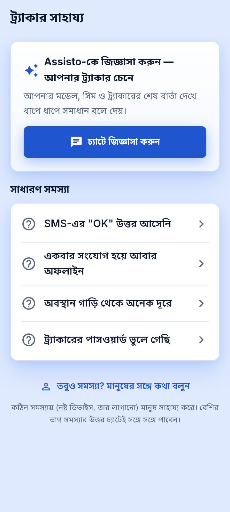 | 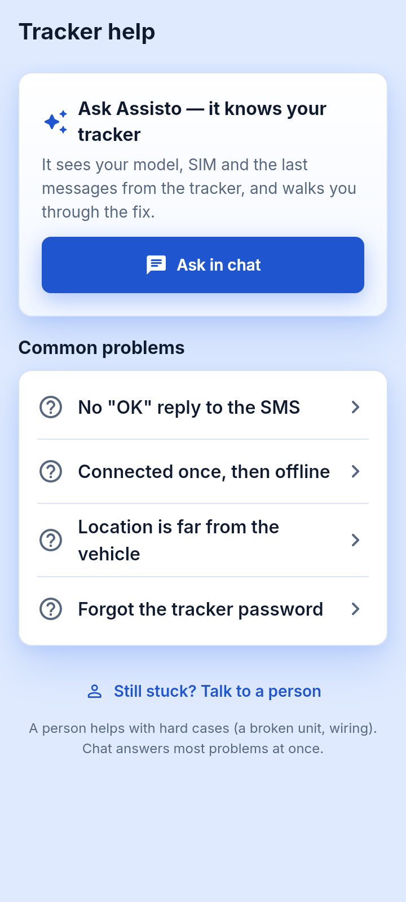 |

## সিসিটিভি যোগ — একই নিজে-করার ধরন

| বাংলা | English |
|---|---|
| 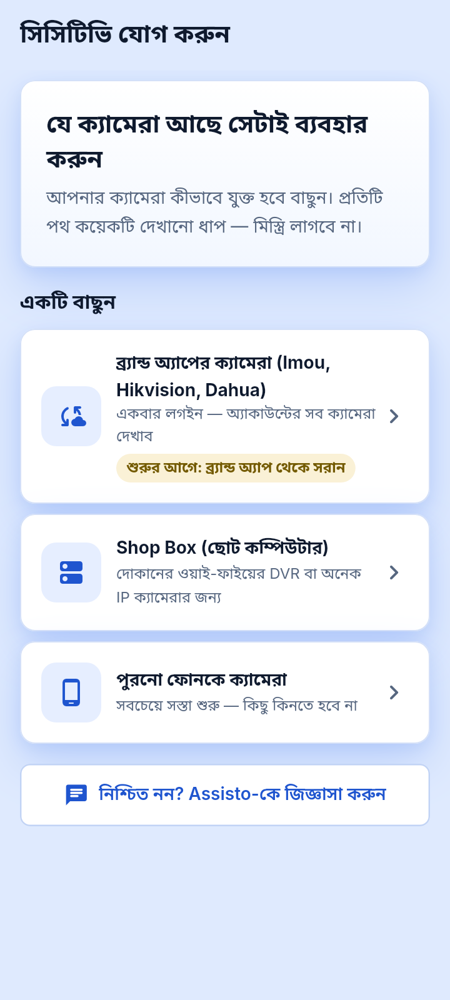 | 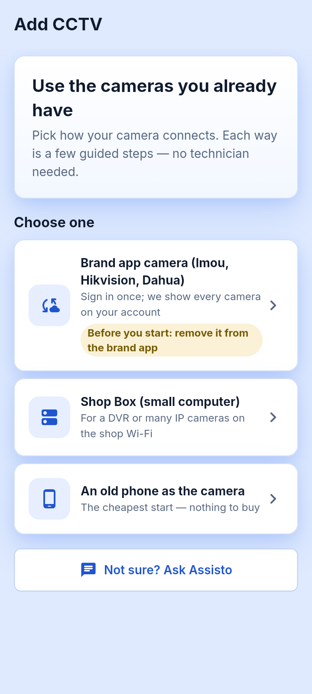 |
